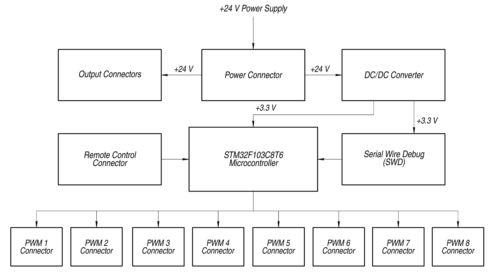
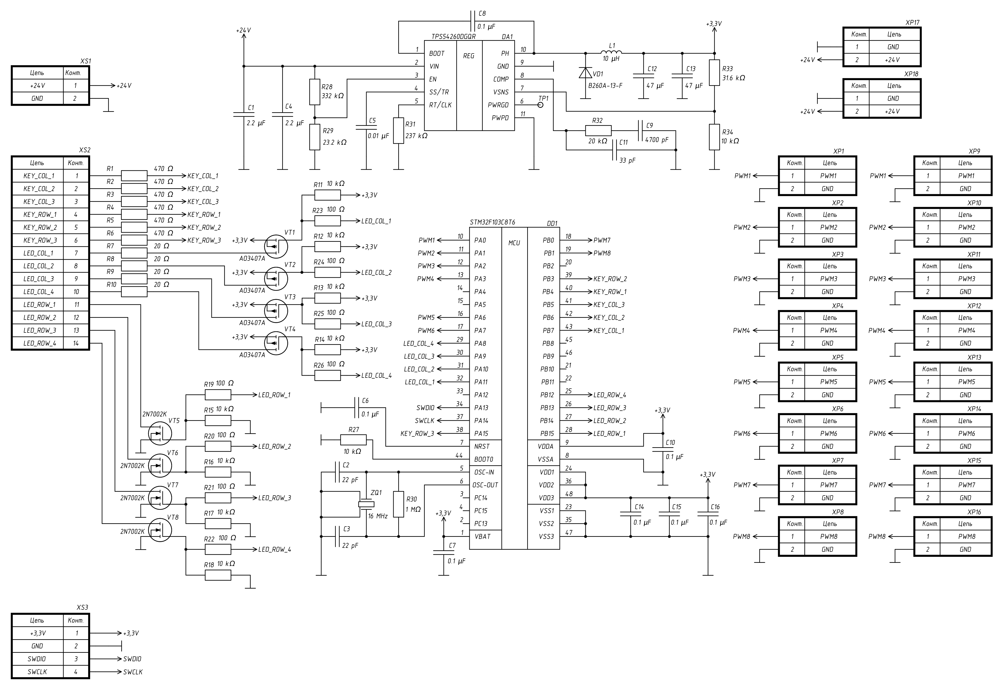
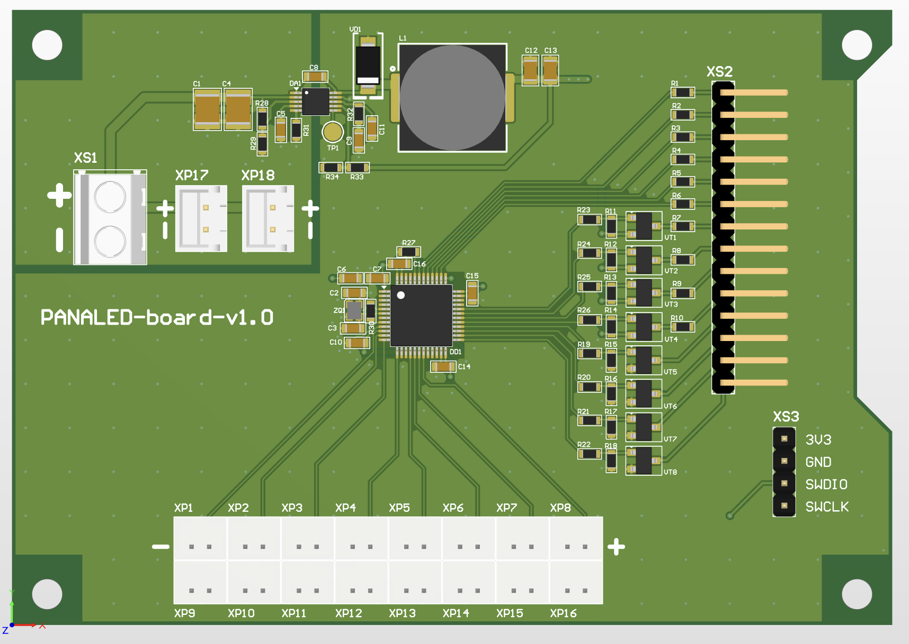
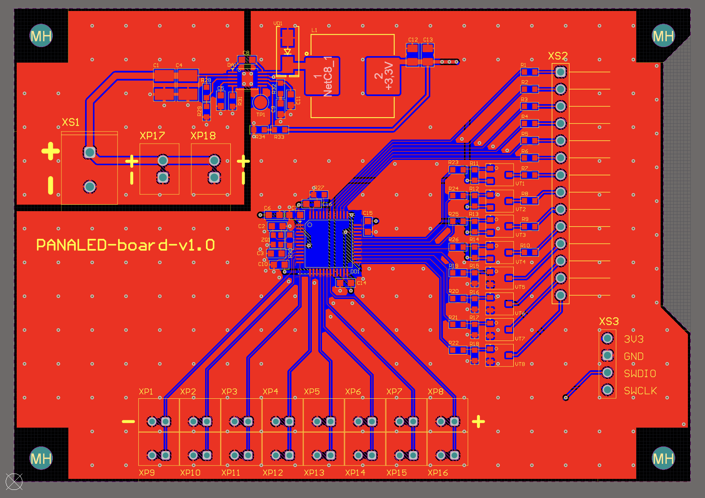
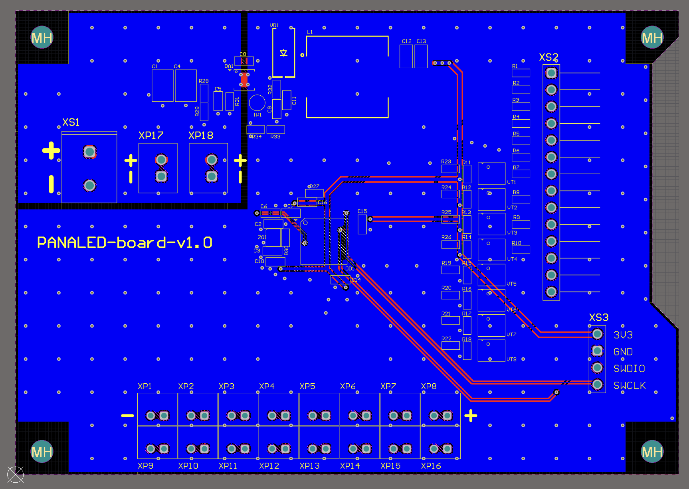
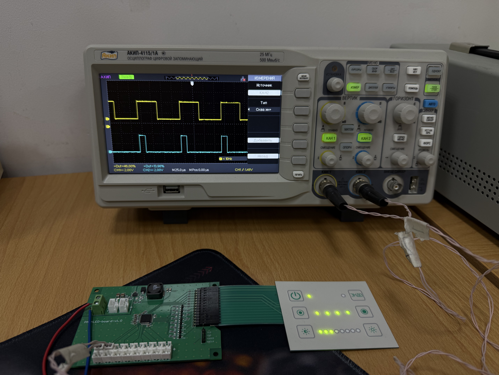

# PWM Controller Board

An STM32-based control board that connects an illuminated matrix keypad to eight PWM control channels. It translates user commands into operating modes, updates the keypad indicators, and generates the corresponding PWM signals for external driver stages.

The board operates from a **24 V DC supply**. An onboard buck converter produces **3.3 V** for the microcontroller and keypad indicator circuitry, while two auxiliary connectors distribute the incoming 24 V supply to external modules.

The design combines power conversion, keypad interfacing, LED-matrix drivers, and PWM signal distribution on a single PCB. The repository contains Altium Designer source files, fabrication outputs, a BOM, and original Russian engineering documentation.

## My Contribution

I independently developed the **PWM Controller Board hardware**, including the schematic, component selection, PCB layout, and engineering documentation in Altium Designer. I also personally assembled and soldered the prototype.

I checked its operation with the illuminated matrix keypad and an external LED driver, and observed the brightness-control PWM signals on an oscilloscope.

## Block Diagram

The power-input section supplies both the DC/DC converter and the auxiliary 24 V outputs. The STM32F103C8T6 reads the keypad matrix, selects the requested operating mode, and updates the panel's LED matrix. At the same time, it sets the PWM outputs associated with that mode. An SWD connector provides access for programming and debugging.

## Schematic

### Power Conversion

DA1, a TPS54260DGQR step-down regulator, converts the 24 V input to 3.3 V. The switching power stage uses the B260A-13-F Schottky diode VD1, a **10 µH inductor L1**, and two **47 µF output capacitors C12/C13**. R33/R34 form the output-voltage feedback divider.

The regulator circuit also includes input filtering, an enable divider, a soft-start capacitor, a switching-frequency setting resistor, and a compensation network. Its power-good signal is accessible at TP1. The 3.3 V rail supplies the controller and LED-matrix switching stages.

### Microcontroller and Clock

DD1 is an **STM32F103C8T6** in an LQFP-48 package. The external clock circuit uses a **16 MHz crystal ZQ1** with C2/C3. Local capacitors decouple the digital, analog, and backup supply connections. R27 pulls BOOT0 low, and C6 is connected to the reset line.

The four-pin XS3 connector exposes **3.3 V, GND, SWDIO, and SWCLK** for programming and debugging. The microcontroller handles operating-mode selection, keypad scanning, indicator updates, and PWM generation.

### Keypad and Indicator Interface

The 14-pin XS2 connector combines two separate matrices:

- **Pins 1–6:** three column and three row lines for a **3×3 button matrix**, supporting up to nine button positions. Each line passes through a 470 Ω series resistor.
- **Pins 7–14:** four column and four row lines for a **4×4 LED matrix**, supporting up to sixteen indicator positions.

The LED columns are switched from the 3.3 V rail by P-channel MOSFETs VT1–VT4 (AO3407A). N-channel MOSFETs VT5–VT8 (2N7002K) switch the rows to ground. The circuit includes gate-series resistors, gate-bias resistors, and 20 Ω resistors in the LED-column paths. This arrangement allows the controller to address the panel indicators by multiplexing rows and columns.

When a button is pressed, the controller identifies its matrix position and processes the command. It then updates the selected indicators and the PWM duty cycles associated with the active mode, keeping the panel indication aligned with the output state.

### PWM Outputs

Eight PWM signals are routed from the microcontroller to two parallel sets of connectors. **XP1–XP8 and XP9–XP16 carry the same eight channels**, giving two connection points per channel. Each connector carries a PWM signal and ground.

These are microcontroller-level control outputs for external driver circuits. The separate XP17/XP18 connectors distribute the 24 V supply.

| Channel | MCU pin | First connector | Duplicate connector |
| --- | --- | --- | --- |
| PWM1 | PA0 | XP1 | XP9 |
| PWM2 | PA1 | XP2 | XP10 |
| PWM3 | PA2 | XP3 | XP11 |
| PWM4 | PA3 | XP4 | XP12 |
| PWM5 | PA6 | XP5 | XP13 |
| PWM6 | PA7 | XP6 | XP14 |
| PWM7 | PB0 | XP7 | XP15 |
| PWM8 | PB1 | XP8 | XP16 |

### Connector Pinout

| Connector | Pin(s) | Signal / Function |
| --- | --- | --- |
| XS1 — power input | 1 / 2 | +24 V / GND |
| XS2 — control panel | 1, 2, 3 | KEY_COL_1, KEY_COL_2, KEY_COL_3 |
| XS2 | 4, 5, 6 | KEY_ROW_1, KEY_ROW_2, KEY_ROW_3 |
| XS2 | 7, 8, 9, 10 | LED_COL_1, LED_COL_2, LED_COL_3, LED_COL_4 |
| XS2 | 11, 12, 13, 14 | LED_ROW_1, LED_ROW_2, LED_ROW_3, LED_ROW_4 |
| XS3 — SWD | 1 / 2 / 3 / 4 | +3.3 V / GND / SWDIO / SWCLK |
| XP1–XP16 — PWM | 1 / 2 | PWM signal / GND |
| XP17, XP18 — power distribution | 1 / 2 | GND / +24 V |

## PCB

### 3D View

### Top Layer

### Bottom Layer

The two-layer PCB groups the DC/DC converter near the power input, places the microcontroller near the centre, and locates the keypad drivers alongside the panel connector. Two rows of PWM connectors provide access to all eight channels. Surface-mount circuitry is combined with through-hole connectors and four mounting holes.

## Assembled Board and Demonstration

The assembled controller is connected to an illuminated matrix keypad and an external [Driver4CH LED driver](https://github.com/sovetnikovmm/driver4ch). The keypad selects operating modes and **eight brightness steps**. The controller updates the panel indicators and the PWM duty cycles associated with the selected mode.
The oscilloscope photograph shows two brightness-control PWM signals with different duty cycles, alongside the operating keypad. It illustrates the output signals used to set LED brightness through external driver stages.

## Bill of Materials

| Designators | Qty | Value / Part | Description | Manufacturer | Part Number | Package |
| --- | ---: | --- | --- | --- | --- | --- |
| C1, C4 | 2 | 2.2 µF | Non-polarized capacitor | Yageo | CC1210KKX7R0BB225 | 1210 |
| C2, C3 | 2 | 22 pF | Non-polarized capacitor | Murata | GRM1885C1H220JA01D | 0603 |
| C5 | 1 | 0.01 µF | Non-polarized capacitor | Murata | GRM1885C1H103JA01D | 0603 |
| C6, C7, C8, C10, C14, C15, C16 | 7 | 0.1 µF | Non-polarized capacitor | Murata | GRM188R72A104KA35D | 0603 |
| C9 | 1 | 4700 pF | Non-polarized capacitor | Murata | GRM1885C1H472JA01D | 0603 |
| C11 | 1 | 33 pF | Non-polarized capacitor | Murata | GRM1885C1H330JA01D | 0603 |
| C12, C13 | 2 | 47 µF | Non-polarized capacitor | Murata | GRM21BR61A476ME15L | 0805 |
| DA1 | 1 | TPS54260DGQR | TPS54260 step-down switching regulator, HVSSOP-10 | Texas Instruments | TPS54260DGQR | HVSSOP-10 |
| DD1 | 1 | STM32F103C8T6 | STM32 microcontroller, LQFP-48 package | ST Microelectronics | STM32F103C8T6 | LQFP-48 |
| L1 | 1 | 10 µH | Inductor | Coilcraft | MSS1260-103MLD | SMD |
| R1, R2, R3, R4, R5, R6 | 6 | 470 Ω | Fixed resistor | Yageo | RC0603FR-07470RL | 0603 |
| R7, R8, R9, R10 | 4 | 20 Ω | Fixed resistor | Yageo | RC0603FR-0720RL | 0603 |
| R11, R12, R13, R14, R15, R16, R17, R18, R27, R34 | 10 | 10 kΩ | Fixed resistor | Yageo | RC0603FR-0710KL | 0603 |
| R19, R20, R21, R22, R23, R24, R25, R26 | 8 | 100 Ω | Fixed resistor | Yageo | RC0603FR-07100RL | 0603 |
| R28 | 1 | 332 kΩ | Fixed resistor | Yageo | RC0603FR-07332KL | 0603 |
| R29 | 1 | 23.2 kΩ | Fixed resistor | Yageo | RC0603FR-0723K2L | 0603 |
| R30 | 1 | 1 MΩ | Fixed resistor | Yageo | RC0603FR-071ML | 0603 |
| R31 | 1 | 237 kΩ | Fixed resistor | Yageo | RC0603FR-07237KL | 0603 |
| R32 | 1 | 20 kΩ | Fixed resistor | Yageo | RC0603FR-0720KL | 0603 |
| R33 | 1 | 31.6 kΩ | Fixed resistor | Yageo | RC0603FR-0731K6L | 0603 |
| VD1 | 1 | B260A-13-F | Schottky diode; pin 1 anode, pin 2 cathode | Diodes Incorporated | B260A-13-F | DO-214AC |
| VT1, VT2, VT3, VT4 | 4 | AO3407A | P-channel MOSFET; pins G gate, S source, D drain | UMW | AO3407A | SOT-23 |
| VT5, VT6, VT7, VT8 | 4 | 2N7002K | N-channel MOSFET; pins G gate, S source, D drain | Hottech | 2N7002K | SOT-23 |
| XP1, XP2, XP3, XP4, XP5, XP6, XP7, XP8, XP9, XP10, XP11, XP12, XP13, XP14, XP15, XP16 | 16 | DS1066-02M | 2-pin connector, DS1066 series | Connfly Electronics | DS1066-02M | THT |
| XP17, XP18 | 2 | DS1069-2 M | 2-pin connector, DS1069 series | Connfly Electronics | DS1069-2 M | THT |
| XS1 | 1 | DG127-5.08-02P-14-1000 | 2-pin screw terminal block | Degson Electronics | DG127-5.08-02P-14-1000 | THT |
| XS2 | 1 | DS-1022-1x14R | 14-pin connector | Connfly Electronics | DS-1022-1x14R | THT |
| XS3 | 1 | DS-1021-1x4 | 4-pin connector | Connfly Electronics | DS-1021-1x4 | THT |
| ZQ1 | 1 | 16 MHz | Quartz crystal; pins 1/3 crystal, 2/4 metal case | CTS | 402WF16012ILR | SMD |

[CSV BOM](docs/pwm-controller-board.csv) · [Altium BOM document](hardware/altium/pwm-controller-board.BomDoc)

## Documentation (Russian)

- [E1 — Block diagram](docs/original-ru/pwm-controller-board_E1_block-diagram.pdf)
- [E3 — Schematic](docs/original-ru/pwm-controller-board_E3_schematic.PDF)
- [PE3 — Parts list](docs/original-ru/pwm-controller-board_PE3_part-list.pdf)
- [PP — PCB drawing](docs/original-ru/pwm-controller-board_PP_board-drawing.PDF)
- [SB — Assembly drawing](docs/original-ru/pwm-controller-board_SB_assembly-drawing.pdf)
- [SP — Product specification](docs/original-ru/pwm-controller-board_SP_specification.pdf)

## Design and Fabrication Files

- [Altium Designer project](hardware/altium/pwm-controller-board.PrjPcb)
- [Schematic source](hardware/altium/pwm-controller-board_E3_schematic.SchDoc)
- [PCB source](hardware/altium/pwm-controller-board.PcbDoc)
- [Schematic library](hardware/altium/libs/pwm-controller-board.SchLib)
- [Footprint library](hardware/altium/libs/pwm-controller-board.PcbLib)
- [Gerber archive](fabrication/pwm-controller-board_gerber.zip)
- [STEP model](fabrication/pwm-controller-board.step)
